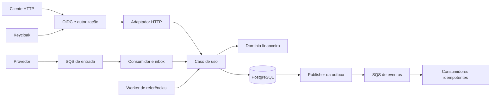
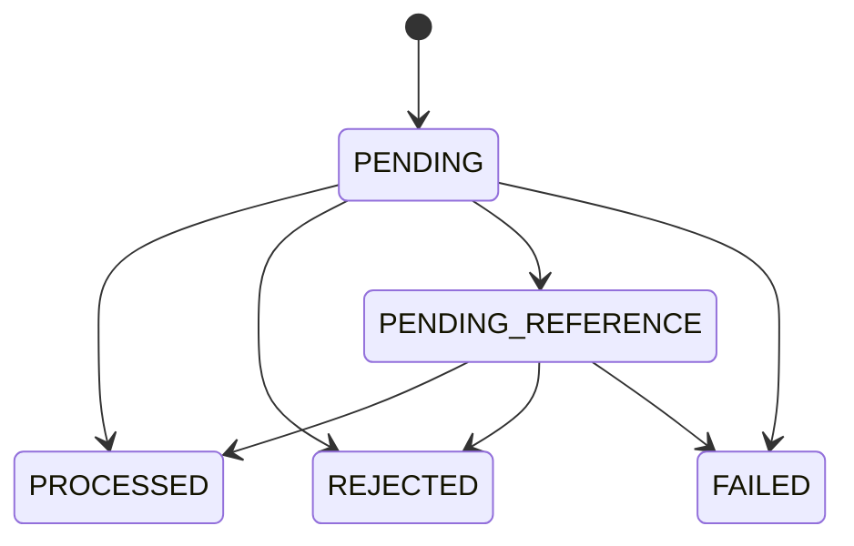

# Arquitetura

Decisões de projeto da solução do [desafio oficial da Jungle Gaming](https://github.com/junglegaming/backend-challenge-go). O [README](README.md) explica como executar; a [matriz de critérios](docs/CHALLENGE_ANALYSIS.md) liga cada requisito ao teste que o exercita; [docs/VALIDATION.md](docs/VALIDATION.md) lista os comandos e os resultados das verificações.

## 1. Visão geral

Um **monólito modular** em Go: um binário replicável com API HTTP, consumidor SQS, worker de referências, publisher da outbox e observador de métricas. Várias instâncias independentes compartilham PostgreSQL, SQS e Keycloak. O banco é a autoridade para saldo, identidade das operações e coordenação entre processos; a instância não guarda estado financeiro em memória. Locks locais e a deduplicação do FIFO não fazem parte da prova de correção.

O efeito financeiro completo (operação, saldo, ledger, resultado, inbox e eventos) acontece em **uma única transação SQL**. Nenhuma chamada ao SQS ou ao IdP ocorre dentro dela. O domínio não depende de framework, protocolo, driver nem do container de injeção.



## 2. Stack e organização

| Responsabilidade | Decisão |
| --- | --- |
| HTTP | `net/http` |
| Composição | Uber Fx: um `fx.Module` por responsabilidade (seção 13) |
| Persistência | `pgx/v5` e SQL explícito; locks e limites transacionais visíveis |
| Banco | PostgreSQL 18, migrations SQL com `golang-migrate` |
| Mensageria | AWS SDK for Go v2, SQS FIFO; emulador MiniStack (aplica as políticas IAM), LocalStack como alternativa |
| Identidade | Keycloak, OAuth 2.0 `client_credentials`, JWT verificado por biblioteca OIDC |
| Operação | Docker Compose, `log/slog` em JSON, métricas Prometheus |
| Testes | `testing`; PostgreSQL, Keycloak e broker reais em containers nos testes de integração e E2E |

Versões fixas: Go 1.27.2, PostgreSQL 18.6, Keycloak 26.8.0, MiniStack 1.5.25 (por digest).

```text
cmd/server/            composição Fx e ciclo de vida
internal/domain/       Money, comandos, regras (Evaluate), carteira, transação, ledger, eventos
internal/store/        PostgreSQL: transações, inbox, outbox, ledger, reconciliação
internal/application/  casos de uso e autorização (compartilhados por HTTP e SQS)
internal/httpapi/      rotas, validação estrita, erros padronizados
internal/messaging/    consumidor SQS, envelope, publisher da outbox
internal/workers/      referências pendentes e métricas de fila/outbox
internal/auth/         validação OIDC/JWT
migrations/            esquema, constraints, triggers e grants
```

O domínio tem campos privados, construtores validados e métodos de transição. Criação e reidratação são distintas: carregar uma entidade nunca movimenta saldo nem emite eventos. Valores zero inválidos são rejeitados. Erros de domínio são classificáveis com `errors.As`; rejeições de negócio não usam `panic`. Toda operação de I/O recebe `context.Context`.

## 3. Dinheiro

`Money` guarda `minorUnits int64` e a moeda (BRL, USD, EUR), com escala fixa de duas casas. O banco usa `BIGINT` e o código da moeda; o JSON usa somente strings decimais. Não há `float` em parsing, cálculo, hash, serialização, persistência ou reconciliação.

A entrada externa aceita só `^(0|[1-9][0-9]*)\.[0-9]{2}$`: `"25.00"` é válido; `"25"`, `"25.0"`, `"025.00"`, espaços, sinais, expoentes, números JSON, `NaN` e `Infinity` não. Nada é normalizado nem arredondado. Soma, subtração e negação verificam overflow, e operações entre moedas diferentes falham. `BET`, `WIN`, `REFUND` e `ROLLBACK` exigem valor positivo, `LOSS` exige zero e só a abertura aceita saldo inicial zero. Os endpoints aceitam BRL; os tipos USD e EUR existem para exercitar a incompatibilidade de moedas.

## 4. Modelo persistido e proteção no banco

| Tabela | Conteúdo e garantias |
| --- | --- |
| `wallets` | ID, jogador, moeda, saldo, versão, timestamps; `UNIQUE(player_id, currency)`, `CHECK(balance_minor >= 0)`, versão positiva |
| `wager_transactions` | Identidade, origem, campos de negócio, hash, estado, referência, falha e snapshot do resultado |
| `wallet_ledger_entries` | Movimento, saldos anterior/posterior, versão; imutável |
| `inbox_messages` | Consumidor, message ID, emissor autenticado, hash, transação, conclusão e disposição `ACK`/`DLQ` |
| `outbox_events` | Evento imutável e metadados mutáveis de entrega (tentativas, próximo envio, lease, publicação) |

IDs internos são UUIDs; timestamps são UTC. Principais constraints:

- Unicidade imediata de `(provider_id, idempotency_key)` e de `(provider_id, external_transaction_id)` para operações externas; `CHECK` distingue a abertura interna dos cinco tipos externos.
- Índice único parcial sobre a referência resolvida de reversões `PROCESSED`: no máximo uma reversão bem-sucedida por transação, somando `REFUND` e `ROLLBACK`.
- Ledger com `UNIQUE(wallet_id, transaction_id)`, `UNIQUE(wallet_id, wallet_version)`, valor positivo e equação débito/crédito conferida em SQL.
- A role de runtime não é dona das tabelas, não é superuser e não tem `UPDATE`, `DELETE` nem `TRUNCATE` no ledger. Triggers protegem o ledger, os campos de negócio e os resultados terminais; na outbox só os metadados de entrega mudam.
- Constraint triggers diferíveis conferem, no commit, que toda mudança de saldo tem exatamente um lançamento coerente (saldo anterior/posterior e versão), que uma operação processada com efeito tem seu lançamento, e que `LOSS`, rejeições e falhas não têm. A versão sobe uma unidade só quando o saldo muda.

O modelo é um ledger de movimentos simples (sem partidas dobradas): a soma do ledger reconstrói o saldo, e `wallets` é a projeção corrente atualizada no mesmo commit.

## 5. Fronteira transacional e concorrência

Uma operação financeira é uma transação `READ COMMITTED` com `SELECT ... FOR UPDATE` na carteira. O lock dura até o commit e só afeta a mesma carteira; carteiras independentes avançam em paralelo.

1. Autenticar, autorizar, validar formato e produzir o comando canônico antes de qualquer I/O financeiro.
2. Abrir a transação. Na entrada SQS, reservar a inbox antes de qualquer lock de carteira.
3. Consultar as identidades persistentes; replay ou conflito encerra o caminho sem recalcular regras.
4. Bloquear a carteira e reler as identidades para cobrir a corrida entre consultas.
5. Inserir a operação em `PENDING` com `ON CONFLICT DO NOTHING`; se não inserir, classificar replay ou conflito.
6. Avaliar a regra (`domain.Evaluate`), validar a transição no agregado e persistir saldo, ledger, resultado e eventos.
7. Concluir a inbox e fazer um único commit; só então responder HTTP ou executar `DeleteMessage`.

`PENDING` existe só dentro da transação e nunca é confirmado sozinho; uma proteção do banco impede a persistência acidental. O saldo é atualizado com versão esperada e saldo não negativo como condições adicionais. Deadlocks e falhas de serialização desfazem a transação e a repetem até três vezes, com contagem em métrica. Falha de conexão ou timeout nunca vira rejeição de negócio, e um resultado de commit desconhecido é resolvido pelas identidades duráveis numa nova tentativa, nunca por uma segunda movimentação.

O registro do resultado de uma operação que estourou o prazo usa contexto próprio: reutilizar o contexto expirado impediria agendar o retry (outbox) ou aplicar o atraso de redelivery (consumidor).

## 6. Idempotência entre HTTP e SQS

O escopo da chave é o provedor autenticado. `Idempotency-Key` (HTTP) e `data.idempotencyKey` (SQS) são preservadas sem substituição. O `payload_hash` é o SHA-256 de um JSON canônico (RFC 8785/JCS sobre strings e objetos) com `providerId`, `externalTransactionId`, `playerId`, `walletId`, `roundId`, `gameId`, `kind`, `money` e a referência opcional. Campos desconhecidos, chaves duplicadas, Unicode inválido e múltiplos objetos são recusados.

| Situação no mesmo provedor | Resultado |
| --- | --- |
| Mesma chave e mesmo hash | Resultado persistido, `idempotentReplay: true` |
| Mesma chave e hash diferente | `409 IDEMPOTENCY_CONFLICT` |
| Mesmo ID externo com outra chave | `409 EXTERNAL_TRANSACTION_CONFLICT` |
| Nenhuma identidade existente | Processa uma vez, sujeito às unicidades do banco |

A autorização precede a consulta de replay. O resultado persistido contém saldo observado, versão, estado e código de falha da época; o saldo posterior de outras operações não altera o replay.

## 7. Operações, referências e estados

| Operação | Regra |
| --- | --- |
| `OPENING` | Interna; saldo positivo cria crédito e dois eventos no commit da carteira (versão 1) |
| `BET` | Débito; `INSUFFICIENT_FUNDS` se faltar saldo |
| `WIN` | Crédito; referência opcional a uma `BET` processada |
| `LOSS` | Valor zero; processada, sem ledger |
| `REFUND` | Crédito integral de uma `BET` processada |
| `ROLLBACK` | Inverso integral de uma `BET`, `WIN` ou `REFUND` processada |

Toda referência exige mesmo provedor, jogador, carteira, moeda, rodada e jogo; reversões exigem valor idêntico ao original. **Política conservadora:** uma transação é alvo de no máximo uma reversão bem-sucedida, somando os tipos. Uma reversão que debitaria mais do que o saldo falha com `REVERSAL_INSUFFICIENT_FUNDS`.



O agregado `WagerTransaction` valida cada transição antes de qualquer escrita: estados terminais (`PROCESSED`, `REJECTED`, `FAILED`) são imutáveis, `REJECTED`/`FAILED` exigem código e `PROCESSED` exige saldo e versão. O relógio de uma transição é limitado ao último `updatedAt`, não recusado.

**Referências pendentes.** Uma reversão cuja referência não existe ou ainda não terminou fica `PENDING_REFERENCE` (HTTP `202`) e é concluída por um worker de qualquer instância: `FOR UPDATE SKIP LOCKED`, lease de 30 s com token novo a cada reserva, backoff exponencial de 1 s a 5 min com jitter, TTL de 24 h contado pelo relógio do banco. Ao expirar, vira rejeição `REFERENCE_NOT_FOUND` (ausente) ou `REFERENCE_NOT_READY` (ainda pendente). Um erro ao processar uma pendência adia a próxima tentativa com o mesmo backoff, e nunca decide o destino da transação.

**`FAILED`.** O contrato oficial define `FAILED` como falha permanente de infraestrutura registrada para auditoria. A solução o produz em **um** caso: a carteira não consegue mais avançar o contador de versão (`int64` esgotado) e a decisão exige movimento. É a impossibilidade técnica permanente de registrar a movimentação: o contador nunca diminui, então nenhuma nova tentativa pode funcionar, e o estado é determinístico, sem depender de timing. O resultado é persistido sem ledger nem evento, o saldo fica intocado, o HTTP responde `500`, e o replay devolve o mesmo resultado. Decisões que não exigem movimento (`LOSS`, uma `BET` que já seria `INSUFFICIENT_FUNDS`) continuam normais.

Fora esse caso, nada vira `FAILED`: erros de banco ou SQS, timeouts, deadlines e commit incerto são transitórios ou não provam nada (um timeout não prova que o commit não ocorreu), uma falha do publisher não reclassifica uma operação processada, e "estado persistido que não restaura" já foi um defeito do próprio código (relógio, seção 11), não um fato sobre a transação.

## 8. Inbox, SQS e DLQ

Filas FIFO `wager-transactions.fifo` (entrada) e `wallet-events.fifo` (saída), cada uma com sua DLQ: redrive após 5 recebimentos, long polling de 20 s, visibilidade de 60 s, retenção de 14 dias. `MessageGroupId = walletId` (validado contra o corpo), `MessageDeduplicationId = SHA-256(providerId:messageId)`. O tratamento de cada mensagem tem prazo de 10 s.

A inbox tem `UNIQUE(consumer_name, message_id)` e um hash do envelope canônico (incluindo `type`, `occurredAt`, `idempotencyKey`) **mais o client id autenticado do emissor**. O mesmo message ID com conteúdo ou emissor diferente é conflito, nunca replay.

| Resultado do tratamento | Mensagem |
| --- | --- |
| Processada, rejeição de negócio ou referência pendente (persistido) | Inbox `ACK` no mesmo commit; depois `DeleteMessage` |
| Reentrega de mensagem concluída | Removida, sem segundo efeito |
| Erro transitório (banco, IdP) | Mantida; visibilidade ajustada para 5, 10, 20, 40 s |
| Envelope, token ou grupo inválidos; conflito de hash ou identidade; `FAILED` | Nunca removida; visibilidade de 2 s e o redrive do broker a leva à DLQ após 5 recebimentos (~10–15 s) |

Não há envio manual à DLQ seguido de exclusão: o redrive é do broker. Numa fila FIFO, uma mensagem que nunca terá sucesso retém o resto do grupo (a carteira) até chegar à DLQ; a visibilidade curta limita isso a segundos. O encerramento gracioso deixa o long poll em andamento terminar: cancelá-lo permitiria ao broker entregar uma mensagem a uma requisição abandonada, invisível por todo o timeout de visibilidade.

## 9. Outbox e eventos

Os eventos têm envelope tipado: `eventId`, `eventType`, `aggregateId = walletId`, `correlationId`, `causationId`, `occurredAt`, `version` e `data`. Tipos: `WagerTransactionProcessed`, `WagerTransactionRejected`, `WagerTransactionPendingReference` e `WalletBalanceChanged`. `LOSS` gera só o evento de processamento; a abertura positiva gera processamento e saldo, com origem interna; `FAILED` não gera evento de integração. Replay e tentativas de referência não geram eventos adicionais.

O publisher reserva eventos vencidos com `FOR UPDATE SKIP LOCKED` e lease de 30 s, faz commit e só então envia ao SQS (timeout de 10 s), marcando `published_at` numa transação separada condicionada ao token. Falhas agendam backoff com jitter, sem descartar eventos. Crash entre o envio e a marcação republica com **o mesmo `eventId`**. A entrega é **at-least-once**: o consumidor deduplica por `eventId`. Publishers concorrentes podem enviar fora de ordem; o contrato não promete ordem financeira, e consumidores usam `walletVersion` para ordenar e detectar lacunas.

## 10. Autenticação e autorização

O realm `jungle` tem os clientes confidenciais `provider-a`, `provider-b` e `wallet-service`, importados de um arquivo versionado. Os tokens vêm do Keycloak por `client_credentials`; a aplicação não emite tokens nem guarda senhas. A validação confere assinatura (JWKS), algoritmo, `iss`, `aud`, `exp`, `nbf` e a role exigida; chave desconhecida ou JWKS indisponível não abrem exceção.

| Principal | Permissão |
| --- | --- |
| `provider-a` / `provider-b` | Criar e consultar somente suas transações (`wager:write` / `wager:read`) |
| `wallet-service` | Abrir e consultar carteiras, ledger e reconciliação |
| Público | Somente `/health/live` e `/health/ready` |

O `providerId` é derivado do cliente autenticado, nunca do corpo; divergência no corpo ou no caminho produz `403`, e a consulta de transação de outro provedor produz `404`.

**Identidade do provedor na fila.** No SQS, o provedor é estabelecido pelo **JWT OIDC** que viaja no atributo `Authorization` de cada mensagem. O consumidor o valida, passa o principal autenticado ao mesmo caso de uso do HTTP e usa o client id como emissor na inbox. O atributo `SenderId` não é usado para autorizar o provedor, porque os emuladores avaliados o preenchem com o id da conta, sem distinguir os remetentes.

**Controle de acesso do broker.** Independentemente do JWT, o broker restringe o que cada identidade IAM pode fazer nas filas, com uma identidade por papel e política mínima:

| Identidade | Permissões |
| --- | --- |
| `provider-a`, `provider-b` | `SendMessage` na fila de entrada |
| `jungle-worker` (aplicação) | Receber, apagar e ajustar visibilidade na entrada; `SendMessage` na saída; `GetQueueAttributes` |
| `events-consumer` | Receber e apagar na saída |
| `dlq-operator` | Receber e apagar nas DLQs |

O provisionamento sonda o broker com leituras inofensivas e grava o resultado em `.local/broker-security.json`; o teste E2E `TestBrokerEnforcesQueuePermissionsPerIdentity` exercita 24 recusas e as permissões necessárias, e só executa chamadas que alteram filas depois de provar que o broker recusa (no LocalStack, que não aplica IAM, ele pula).

## 11. Contrato HTTP

`POST /wallets` retorna `201` (duplicação de jogador/moeda: `409 WALLET_ALREADY_EXISTS`). Leituras autorizadas retornam `200`; ausência, `404`.

| HTTP | Caso | Código ou estado |
| --- | --- | --- |
| `200` | Processada ou replay | `PROCESSED` |
| `202` | Espera durável por referência | `PENDING_REFERENCE` e `Location` |
| `400` | Formato, moeda, valor, referência ou chave inválidos | `INVALID_REQUEST`, `INVALID_MONEY`, `UNSUPPORTED_CURRENCY`, `INVALID_REFERENCE`, `IDEMPOTENCY_KEY_REQUIRED` |
| `401` | Token ausente, inválido ou expirado | `UNAUTHENTICATED` |
| `403` | Role ou provedor incompatível | `FORBIDDEN` |
| `404` | Recurso ausente ou não visível | `NOT_FOUND` |
| `409` | Conflito de identidade | `IDEMPOTENCY_CONFLICT`, `EXTERNAL_TRANSACTION_CONFLICT`, `WALLET_ALREADY_EXISTS` |
| `422` | Rejeição de negócio persistida | `REJECTED` e `failureCode` |
| `500` | Falha permanente persistida | `FAILED` (`WALLET_VERSION_EXHAUSTED`), `PROCESSING_FAILED` |
| `503` | Dependência ou deadline transitório | `TEMPORARILY_UNAVAILABLE`, com `Retry-After` |

Códigos de rejeição: `INSUFFICIENT_FUNDS`, `REVERSAL_INSUFFICIENT_FUNDS`, `MONEY_OVERFLOW`, `WALLET_CONTEXT_MISMATCH`, `REFERENCE_NOT_FOUND`, `REFERENCE_NOT_READY`, `REFERENCE_NOT_PROCESSED`, `REFERENCE_CONTEXT_MISMATCH`, `REFERENCE_KIND_NOT_ALLOWED`, `REFERENCE_AMOUNT_MISMATCH`, `REFERENCE_ALREADY_REVERSED`. Erros usam `{"error":{"code","message","retryable"},"correlationId"}`. Rejeições persistidas são definitivas para a operação; em `503`, o cliente repete a mesma chave e o mesmo conteúdo. O `X-Correlation-ID` (`[A-Za-z0-9._:-]{1,128}`) é devolvido e propagado aos eventos como `correlationId`; no SQS vale o `messageId`.

## 12. Leitura, paginação e reconciliação

O ledger é ordenado por `wallet_version, id` com cursor opaco que fixa o limite superior de versão da primeira página (`limit` padrão 50, máximo 100). A reconciliação roda numa transação `REPEATABLE READ READ ONLY`: lê a carteira e soma créditos menos débitos (abertura incluída) no mesmo snapshot, com aritmética exata. Devolve `storedBalance`, `calculatedBalance`, `difference`, `consistent` e `checkedEntries`; uma divergência incrementa métrica e log, e **nunca é corrigida automaticamente**.

## 13. Composição Fx e ciclo de vida

`cmd/server/modules.go` define um `fx.Module` por responsabilidade: observabilidade, banco, aplicação, identidade, broker, consumidor, publisher, referências, observador, supervisor de workers e HTTP. Cada worker entrega seu laço ao *value group* `workers`, e o supervisor reinicia um laço após *panic* e, na parada, cancela todos e espera cada um, registrando `worker stopped` (ou nomeando quem não parou no prazo).

O servidor HTTP é registrado por último e, portanto, é o primeiro a parar: readiness fica negativa, novas requisições são recusadas e o `Shutdown` espera as em andamento. Depois param os workers (o consumidor deixa o long poll terminar) e, por último, o pool do banco fecha. O `Listen` ocorre no início, então porta ocupada falha a partida e desfaz o que os módulos anteriores adquiriram. O `StopTimeout` do Fx é o `SHUTDOWN_TIMEOUT` mais 5 s, e o `stop_grace_period` do Compose é maior que ele.

## 14. Observabilidade e recuperação

Logs JSON com `correlationId`, `messageId`, `transactionId`, `walletId` e `providerId`, sem tokens nem payloads financeiros completos. Métricas: `wager_transactions_total{status,kind}`, `idempotent_replays_total`, `idempotency_conflicts_total`, `processing_retries_total{reason}`, `sqs_dlq_messages`, `wallet_lock_wait_seconds`, `concurrency_conflicts_total`, `outbox_pending_events`, `outbox_oldest_pending_age_seconds`, `wager_processing_duration_seconds{transport}` (`http`/`sqs`) e `wallet_reconciliation_mismatches_total`. `/health/live` não consulta dependências; `/health/ready` verifica PostgreSQL e as duas filas e fica negativa durante o encerramento; `/metrics` exige o cliente interno.

| Interrupção | Resultado |
| --- | --- |
| Antes do commit financeiro | Rollback; retry seguro |
| Depois do commit e antes da resposta HTTP | Replay devolve o resultado original |
| Depois do commit e antes de remover a mensagem SQS | A inbox reconhece a reentrega; sem segundo efeito |
| Depois de persistir uma pendência | Worker de outra instância retoma pelo banco |
| Depois de reservar referência ou evento | O lease expira e outra instância assume |
| Depois de publicar e antes de marcar a outbox | Republicação com o mesmo `eventId` |
| PostgreSQL indisponível | Sem ACK nem falsa conclusão; retry e DLQ conforme o limite |
| SQS indisponível | O HTTP confirma no banco; os eventos aguardam na outbox; readiness falha |

## 15. Estratégia de testes

Três camadas (comandos e resultados em [docs/VALIDATION.md](docs/VALIDATION.md)): **unitários** (domínio, validação, mapeamento HTTP, autorização, métricas); **integração** com PostgreSQL real e a role de runtime (constraints, atomicidade, inbox/outbox, leases, `FAILED`, composição Fx real com substitutos do IdP e do broker); **E2E** com PostgreSQL, Keycloak, broker e três instâncias reais da aplicação, com falhas injetadas pelo Docker (`stop -t 0`, `pause`, `kill`), sem endpoint administrativo e com o binário de produção. Os testes de integração do consumidor usam uma fila SQS falsa; o protocolo real é coberto pelo E2E. Cenários: 50 entregas de uma aposta por HTTP e SQS, disputa de duas apostas de 80 sobre saldo 100, idempotência após reinício de todas as instâncias, crash antes do commit e entre commit e ACK, queda do broker e do banco, `SIGTERM` sob carga, token expirado do Keycloak real, carga mista e caos com verificação do saldo recalculado só das transações persistidas.

## 16. Limitações e escopo

- **O emulador de IAM é parcial.** O MiniStack aplica as políticas das identidades, mas não verifica o segredo da chave de acesso e autoriza pelo nome da chamada (por isso a política nomeia `sqs:DeleteMessageBatch`, que na AWS é coberto por `sqs:DeleteMessage`). O LocalStack Community não aplica IAM. A demonstração local não reproduz toda a autenticação IAM da AWS.
- **Autorização do provedor no SQS vem do JWT**, não do `SenderId` (seção 10).
- **Escopo:** endpoints em BRL; uma carteira por jogador e moeda; uma operação financeira por transação SQL; reversões integrais com a política conservadora da seção 7; ledger sem partidas dobradas.
- **Não implementados:** tracing OpenTelemetry e partidas dobradas (diferenciais opcionais) e alertas (só as métricas); a carga é teste de consistência, sem benchmark de vazão controlado.
- **Eventos** são at-least-once e podem chegar fora de ordem entre publishers concorrentes.
- **Uma mensagem inválida** retém o grupo FIFO da carteira por ~10–15 s até chegar à DLQ.
- **Ambiente local:** Keycloak em modo desenvolvimento, HTTP e segredos de exemplo descartáveis; a VM do Docker pode dar saltos de relógio, por isso a ordem entre `created_at` e `updated_at` não é invariante (o domínio normaliza o par e todos os timestamps de uma carteira vêm do relógio do banco).
