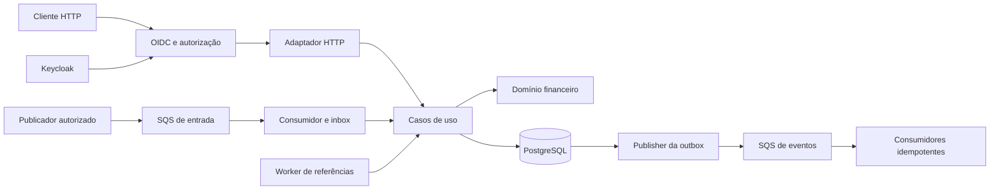
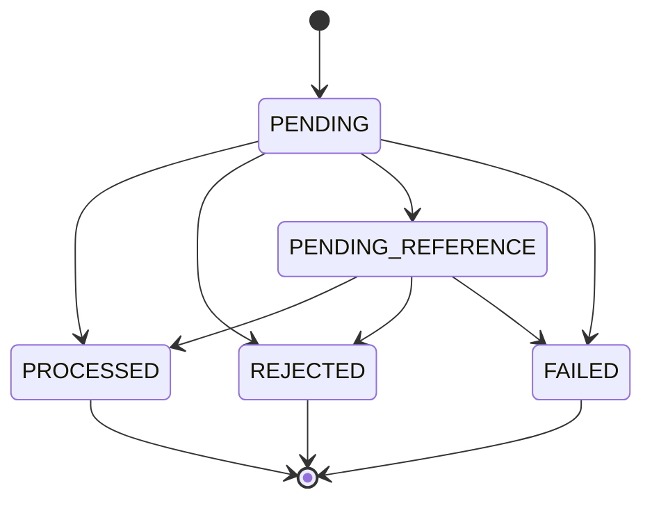

# Arquitetura proposta

**Status: implementado e validado em execução, com as divergências e limites da [seção 16](#16-divergências-e-decisões-da-implementação-verificadas).** Este documento registra as decisões de projeto; o que foi efetivamente comprovado, e por qual teste, está em [docs/CHALLENGE_ANALYSIS.md](docs/CHALLENGE_ANALYSIS.md) e [docs/IMPLEMENTATION_PROGRESS.md](docs/IMPLEMENTATION_PROGRESS.md). Onde o texto abaixo diz "deverá/será", leia a seção 16 para saber se a implementação diverge.

Base: [desafio oficial da Jungle Gaming](https://github.com/junglegaming/backend-challenge-go), consultado em 09/10/2026. Blob do README analisado: `b19a1a5cdc00fa22e13fae9582777ecb7b6ad248`. A [análise do desafio](docs/CHALLENGE_ANALYSIS.md) organiza os critérios de aceitação; o [README](README.md) define a experiência de execução planejada.

## 1. Visão geral e limites

Adotar um **monólito modular**, com um binário replicável contendo API HTTP, consumidor SQS, worker de referências e publisher da outbox. Três processos independentes compartilharão PostgreSQL, SQS e Keycloak. O banco será a autoridade para saldo, identidade das operações e coordenação entre processos.

Essa escolha permite uma única transação SQL para o efeito financeiro completo. Separar carteira, ledger e apostas em serviços exigiria coordenação distribuída adicional sem benefício para o escopo. O domínio não dependerá de framework, protocolo, driver ou container de injeção.



A réplica não terá estado financeiro autoritativo em memória. Locks locais e a deduplicação FIFO não participarão da prova de correção. Nenhuma chamada ao SQS ou ao IdP ocorrerá dentro da transação financeira.

## 2. Stack e organização

| Responsabilidade | Decisão e motivo |
| --- | --- |
| HTTP | `net/http`, suficiente para os contratos e com poucas dependências |
| Composição | Uber Fx, módulos e injeção por construtores |
| Persistência | `pgx/v5`, `pgxpool` e SQL explícito; locks e limites transacionais visíveis |
| Banco | PostgreSQL, migrations SQL versionadas com `golang-migrate` |
| Mensageria | AWS SDK for Go v2, SQS FIFO; emulador MiniStack por padrão (aplica IAM), LocalStack como alternativa sem prova de IAM (§16.1) |
| Identidade | Keycloak, OAuth 2.0 `client_credentials`, access tokens JWT verificados por biblioteca OIDC/JOSE mantida |
| Operação | Docker Compose, `log/slog` em JSON e métricas Prometheus |
| Testes | `testing`, infraestrutura real em containers e processos independentes |

Versões exatas de Go, bibliotecas e imagens serão fixadas no primeiro incremento, depois de verificar compatibilidade. `go.mod`, `go.sum`, Dockerfile e imagens não usarão versões flutuantes. As versões foram fixadas na implementação (Go 1.27.2, PostgreSQL 18.6, Keycloak 26.8.0, MiniStack 1.5.25 por digest).

Estrutura alvo do desenho original (a estrutura **implementada**, mais enxuta, está na seção "Estrutura" do [README](README.md)):

```text
cmd/server/
internal/bootstrap/
internal/config/
internal/domain/money/
internal/domain/wallet/
internal/domain/wager/
internal/domain/event/
internal/application/
internal/adapters/http/
internal/adapters/postgres/
internal/adapters/sqs/
internal/adapters/oidc/
internal/workers/
internal/observability/
migrations/
deploy/keycloak/
deploy/broker/
tests/integration/
tests/e2e/
docs/
```

`application` define interfaces pequenas para o que consome e orquestra `CreateWallet`, `ProcessWager`, `GetTransaction`, `ListLedger` e `ReconcileWallet`. Os adaptadores implementam essas interfaces. `bootstrap` é o ponto que conhece as implementações e Fx. Evitar repositórios genéricos, interfaces para cada struct e camadas sem responsabilidade concreta.

O domínio terá campos privados, construtores validados e métodos de transição. Criação e reidratação serão operações distintas: carregar uma entidade nunca movimenta saldo nem emite eventos. Valores zero inválidos serão rejeitados por todos os métodos públicos relevantes. Erros classificáveis por `errors.Is`/`errors.As`; rejeições de negócio não usam `panic`. Operações de I/O recebem `context.Context`.

## 3. Dinheiro e invariantes

`Money` armazenará `minorUnits int64` e moeda validada, com escala fixa 2. O armazenamento usará `BIGINT` e código da moeda; JSON usará exclusivamente strings decimais. Não haverá conversão para `float32`/`float64`, inclusive em DTOs, hashing, métricas monetárias ou reconciliação.

Para entrada externa, aceitar somente o formato `^(0|[1-9][0-9]*)\.[0-9]{2}$`: `"25.00"` é válido; `"25"`, `"25.0"`, `"025.00"`, espaços, sinais, expoentes, números JSON, `NaN` e `Infinity` são inválidos. Não normalizar valores malformados nem arredondar. O endpoint aceitará BRL; o value object reconhecerá também USD e EUR para exercitar incompatibilidade, todos com duas casas. Códigos não suportados serão rejeitados, mesmo que sejam moedas ISO válidas.

O intervalo interno em unidades principais é de `-92233720368547758.08` a `92233720368547758.07`. O saldo e as entradas financeiras ficam no intervalo não negativo. Parsing acumula dígitos com checagem de limite antes de multiplicar/somar. Soma, subtração e negação verificam overflow antes de calcular; não implementar subtração por negação desprotegida de `MinInt64`. Formatação deve suportar o mínimo negativo sem calcular seu valor absoluto em `int64`.

`Add`, `Subtract`, `Negate` e `Compare` preservam imutabilidade e exigem moedas compatíveis quando aplicável. `Zero(currency)` é válido; `Money{}` não é. `BET`, `WIN`, `REFUND` e `ROLLBACK` exigem valor positivo. `LOSS` exige zero. Só abertura aceita saldo inicial zero.

## 4. Modelo persistido e proteção no banco

| Tabela | Conteúdo e garantias principais |
| --- | --- |
| `wallets` | ID, jogador, moeda, saldo, versão, timestamps; `UNIQUE(player_id, currency)`, `CHECK(balance_minor >= 0)`, versão positiva |
| `wager_transactions` | Identidade, origem, campos de negócio, hash, estado, referência, falha e snapshot do resultado; unicidades e transições protegidas |
| `wallet_ledger_entries` | Movimento, moeda, saldos anterior/posterior, versão financeira e timestamp; registros imutáveis |
| `inbox_messages` | Consumidor, message ID do envelope, principal autorizado, hash, transação, recebimento, conclusão e disposição `ACK`/`DLQ` |
| `outbox_events` | Evento imutável e metadados mutáveis de entrega, tentativas, próximo envio, lease e publicação |

IDs internos serão UUIDs gerados antes do commit. Timestamps serão UTC, `TIMESTAMPTZ` no banco e RFC 3339 no contrato. Identificadores externos serão strings opacas, sensíveis a maiúsculas, sem trim silencioso. Limites de comprimento e tamanho de body serão validados na borda.

### Constraints e permissões

- `wager_transactions`: unicidade de `(provider_id, idempotency_key)` e de `(provider_id, external_transaction_id)` para origem externa. Essas unicidades serão imediatas, não diferíveis, para permitir `ON CONFLICT`. `CHECK` distingue `INTERNAL/OPENING` dos cinco tipos externos e exige ou proíbe os metadados conforme a origem.
- Índice único parcial de `wallet_id` para `OPENING`. Sua identidade estável será o ID da carteira associado ao tipo de abertura; nenhum retry pode criar um segundo crédito inicial.
- Referências internas terão FK. Um índice único parcial sobre `reference_transaction_id`, onde `kind IN ('REFUND', 'ROLLBACK') AND status = 'PROCESSED'`, impedirá duas reversões bem-sucedidas da mesma referência, mesmo de tipos diferentes.
- Ledger: `UNIQUE(wallet_id, transaction_id)`, `UNIQUE(wallet_id, wallet_version)`, FKs, direção válida, valor positivo, saldos não negativos e equação de débito/crédito validada com intermediários SQL `NUMERIC`, sem overflow em `BIGINT`.
- A transação terá FKs simples de existência para carteira e referência resolvida. Igualdade de jogador/moeda/contexto/valor será exigida ao processar com sucesso; uma rejeição precisa preservar o payload original divergente para auditoria. No ledger, FKs compostas e triggers exigirão os mesmos carteira, moeda e valor da operação processada. Uma referência de outro contexto pode ser registrada para explicar a rejeição, mas nunca autorizar um movimento.
- A role de runtime não será dona das tabelas, superuser ou membro da role de migrations. Não terá `UPDATE`, `DELETE` ou `TRUNCATE` no ledger. Triggers impedirão edição/exclusão/truncamento; a role de runtime não poderá desabilitá-las. Outbox protege payload e identidade, permitindo apenas alterações de entrega.
- Triggers protegerão campos de negócio e resultados terminais da transação. Transição de estado válida não significa poder alterar seu payload original.

Para que saldo e ledger não dependam apenas da disciplina dos repositórios, prever constraint triggers diferíveis: ao commit, uma alteração de saldo deve ter exatamente um lançamento correspondente ao saldo anterior/posterior e à versão; o lançamento deve corresponder a uma operação `PROCESSED` com efeito financeiro. Uma operação processada com efeito exige seu lançamento; `LOSS`, rejeições e falhas não o admitem. A verificação cobre também atualização de saldo sem ledger, ledger sem atualização e alterações indevidas de versão, usando uma operação por carteira em cada transação SQL. Impor versão inicial `1`, incremento exato de uma unidade ao mudar saldo e versão inalterada em updates sem efeito. A criação positiva é a exceção explícita de versão `1`; criação zero não exige lançamento. Testes SQL diretos validarão esses mecanismos, inclusive com a role de runtime.

Triggers diferidos de estado relerão a linha final por ID: o `NEW.status` capturado no INSERT ainda pode ser `PENDING`, mesmo após uma transição válida na mesma transação SQL. Para a equação da alteração da carteira, usar os valores `OLD`/`NEW` daquela alteração e conferir o estado final junto ao ledger. A proteção contra alterações de transações já terminais será imediata.

O modelo é um ledger de movimentos da carteira, sem partidas dobradas. A soma do ledger reconstrói o saldo; a tabela `wallets` é a projeção corrente atualizada no mesmo commit.

## 5. Fronteira transacional e concorrência

Um `UnitOfWork.WithinTransaction(ctx, fn)` definido na aplicação fornecerá repositórios vinculados à mesma `pgx.Tx`. Só a unidade de trabalho faz commit/rollback; repositórios não abrem transações próprias nem usam o pool para escritas daquele fluxo. Erro ou cancelamento exige rollback explícito, com contexto curto de limpeza se o original estiver cancelado. A semântica do driver deve ser respeitada: cancelar o contexto de início não substitui a finalização da transação. [Referência pgx](https://pkg.go.dev/github.com/jackc/pgx/v5).

Usar `READ COMMITTED` com `SELECT ... FOR UPDATE` na carteira. O lock dura até o fim da transação e impede escritores concorrentes na mesma linha; outras carteiras não compartilham esse lock. [Locks do PostgreSQL](https://www.postgresql.org/docs/current/explicit-locking.html).

Fluxo de uma operação:

1. Autenticar, autorizar, validar formato e produzir DTO canônico antes do I/O financeiro.
2. Abrir transação. Para SQS, reservar/verificar inbox, sempre antes de adquirir lock da carteira.
3. Consultar as duas identidades persistentes. Replay ou conflito encerra o caminho sem recalcular regras de saldo.
4. Bloquear somente a carteira indicada; reler as identidades para cobrir a corrida entre consultas. Carteira inexistente não é aceita; divergências de jogador/moeda serão rejeições duráveis após registrar a operação original.
5. Inserir a operação em `PENDING` com `ON CONFLICT DO NOTHING`. Se não inserir, consultar ambas as identidades e classificar replay/conflito; nunca ignorar uma violação de unicidade.
6. Validar referência e regras. Atualizar agregado e ledger, ou persistir rejeição/pendência. Referência de outra carteira é rejeitada sem adquirir lock nessa segunda carteira.
7. Persistir estado, snapshot do resultado e eventos; concluir inbox quando aplicável; fazer um único commit.
8. Retornar HTTP ou executar `DeleteMessage` conforme a disposição da inbox.

Ordem compartilhada: inbox, quando existir; carteira; transação e referência; ledger e outbox. O worker de referências reserva trabalho em uma transação curta separada e solta seus locks antes de entrar nessa ordem. Nenhum worker segura lock de transação esperando uma carteira que outro fluxo já bloqueou.

No primeiro corte, `PENDING` é intermediário dentro da transação SQL e **não será confirmado sozinho**. Operações sem referência pendente terminam no mesmo commit. Uma proteção diferível impedirá a persistência acidental de `PENDING`; aceitar esse estado de forma assíncrona no futuro exigiria antes uma fila durável de retomada.

O saldo será atualizado com versão esperada e saldo não negativo como condições adicionais; uma linha afetada é obrigatória. Versão inicia em `1` e cresce uma unidade somente por mudança de saldo. `LOSS`, rejeição, pendência e replay não a alteram.

Deadlocks e falhas de serialização fazem rollback completo e até três tentativas com backoff curto, limitadas pelo deadline. Falha de conexão/timeout não vira rejeição de negócio. Resultado desconhecido do commit é resolvido pelas identidades duráveis em uma nova consulta/reentrega, nunca por uma segunda movimentação com outra chave ou um `FAILED` presumido.

## 6. Idempotência entre HTTP e SQS

O escopo da chave é o provedor autenticado. Preservar exatamente `Idempotency-Key` no HTTP e `data.idempotencyKey` no SQS. Não gerar uma substituta no servidor. Exigir 1 a 128 caracteres ASCII imprimíveis sem espaços.

O `payload_hash` será SHA-256 sobre UTF-8 de JSON canônico com chaves ordenadas recursivamente, sem espaços insignificantes. Usar RFC 8785/JCS sobre uma estrutura restrita a strings e objetos; não passar por `map[string]any` que converta números monetários. Campos incluídos: `providerId`, `externalTransactionId`, `playerId`, `walletId`, `roundId`, `gameId`, `kind`, `money.amount`, `money.currency` e referência opcional. UUIDs serão normalizados para representação minúscula; dinheiro já exige duas casas; a referência ausente será omitida. `null` ou string vazia não equivalem a ausência.

Excluir chave de idempotência, timestamps do envelope, message IDs, tracing e headers. Rejeitar campos JSON desconhecidos, chaves JSON duplicadas, Unicode inválido e mais de um objeto no body. Não substituir silenciosamente caracteres inválidos; ordenar um mapa e chamar `encoding/json` isoladamente não garante conformidade com JCS. `BET` e `LOSS` não aceitam referência; `WIN` admite; reversões exigem. Incluir vetores fixos de hash compartilhados pelos dois adaptadores. [Especificação JCS](https://www.rfc-editor.org/rfc/rfc8785).

| Situação no mesmo provedor | Resultado |
| --- | --- |
| Mesma chave e mesmo hash | Resultado persistido, `idempotentReplay: true` |
| Mesma chave e hash diferente | `409 IDEMPOTENCY_CONFLICT` |
| Mesmo ID externo com outra chave, mesmo que o hash coincida | `409 EXTERNAL_TRANSACTION_CONFLICT`; cliente deve usar a chave original |
| Nenhuma identidade existente | Processar uma vez, sujeito às unicidades do banco |

Se chave e ID externo apontarem para registros diferentes, responder conflito, sem escolher arbitrariamente um deles. Provedores diferentes podem usar a mesma chave. Autorização precede consulta, replay e resolução das identidades; queries incluem `provider_id` do principal. O snapshot persistido contém saldo observado, versão, estado, failure code e timestamps do processamento; saldo posterior de outras operações não muda o replay. Uma pendência pode evoluir e seu replay refletirá o estado durável atual até se tornar terminal.

## 7. Operações, referências e reversões

| Operação | Política proposta |
| --- | --- |
| `OPENING` | Interna; saldo positivo cria crédito e dois eventos no commit da carteira, mantendo versão 1. Saldo zero não cria operação financeira |
| `BET` | Débito positivo, rejeitado com `INSUFFICIENT_FUNDS` se não houver saldo |
| `WIN` | Crédito positivo. Referência opcional deve ser uma `BET` processada do mesmo contexto; valor do prêmio não precisa igualar a aposta |
| `LOSS` | Valor zero, operação processada e evento de processamento; sem ledger ou evento de saldo |
| `REFUND` | Crédito integral de uma `BET` processada, ainda sem reversão bem-sucedida |
| `ROLLBACK` | Inverso integral do movimento de uma `BET`, `WIN` ou `REFUND` processada, ainda sem reversão bem-sucedida |

Toda referência exige mesmo provedor, jogador, carteira, moeda e rodada. Adotar também igualdade de `gameId` para evitar referência cruzada entre jogos. Reversão exige valor idêntico ao original. Autorreferência é inválida; `ROLLBACK` de `ROLLBACK`, de `LOSS` ou de `OPENING` será rejeitado. `WIN` sem referência é permitido; não inferir dependência pelo round ID.

**Política conservadora:** uma transação só poderá ser alvo de uma reversão bem-sucedida durante toda sua vida, somando os tipos. Assim, `REFUND(BET)` e `ROLLBACK(BET)` são mutuamente exclusivos. `ROLLBACK(REFUND)` é permitido e debita o crédito daquele refund, mas não libera a aposta para nova reversão. A sequência de movimentos é `-X, +X, -X`. Isso limita ciclos de compensação, simplifica a prova de correção e atende ao escopo sem devolução duplicada. Reversões rejeitadas não consomem essa unicidade.

Rollback que debita mais que o disponível resulta em `REVERSAL_INSUFFICIENT_FUNDS`, distinto da insuficiência de uma aposta. Não permitir saldo negativo nem cobrança parcial. Um resultado rejeitado é terminal; o mesmo ID/chave não será reaplicado após recarga de saldo.

### Máquina de estados



Estados terminais são imutáveis. Retry de referência mantém `PENDING_REFERENCE`, alterando apenas seus metadados de tentativa até concluir. As setas de `PENDING` acontecem antes do primeiro commit.

Referência ausente ou ainda pendente mantém a operação em `PENDING_REFERENCE`. Persistir `first_pending_at`, `expires_at`, `attempt_count`, `next_attempt_at`, `lease_token` e `lease_until`. Emitir `WagerTransactionPendingReference` apenas na entrada nesse estado. O mesmo mecanismo vale para a referência opcional de `WIN`, quando fornecida.

TTL inicial de 24 horas; backoff exponencial de 1 segundo até 5 minutos, com jitter entre 50% e 100% do intervalo. O TTL usa relógio do banco e não é renovado por reenvios. Ao expirar, rejeitar com `REFERENCE_NOT_FOUND` se ausente, ou `REFERENCE_NOT_READY` se ainda pendente. Referência `REJECTED`/`FAILED` produz `REFERENCE_NOT_PROCESSED` imediatamente. Tipo/contexto/valor incompatível é rejeição definitiva. Ciclos não terão tratamento especial além da validação de tipo/autorrefência e expiração; nunca movimentar saldo por uma referência ainda não processada.

Workers usam `FOR UPDATE SKIP LOCKED` para reservar lotes pequenos, com lease de 30 segundos e token novo a cada reserva. A reserva termina antes do lock da carteira. Dentro do processamento, revalidar estado, token e validade do lease; se perdeu a reserva, abandonar. Um worker morto terá suas linhas assumidas após expiração. Retentativa, resultado e novos eventos são persistidos atomicamente. TTL expirado durante indisponibilidade será observado assim que o banco voltar.

`FAILED` fica reservado a falha permanente de infraestrutura comprovada que impeça concluir uma operação válida, por exemplo payload durável em versão definitivamente não suportada. Erros transitórios de banco/SQS, interrupções, deadline ou commit incerto não autorizam essa transição. A gravação de `FAILED` requer banco disponível e prova de que não houve commit financeiro; caso contrário preservar/reentregar. Nenhuma falha posterior no publisher transforma uma operação processada em `FAILED`.

## 8. Inbox, SQS e DLQ

Filas de entrada `wager-transactions.fifo` e `wager-transactions-dlq.fifo`, com redrive de cinco recebimentos, long polling de 20 segundos e visibility inicial de 60 segundos. Deadline por tratamento de 10 segundos; leituras long polling terão timeout HTTP maior que a espera. Um batch não pode consumir sua visibilidade aguardando na memória: buscar somente até a capacidade disponível e processar mensagens do mesmo grupo sequencialmente. Renovar visibilidade quando necessário, com limite e cancelamento observável. [Visibilidade SQS](https://docs.aws.amazon.com/AWSSimpleQueueService/latest/SQSDeveloperGuide/sqs-visibility-timeout.html).

`MessageGroupId = walletId`, validado contra o body; permite paralelismo entre carteiras. `MessageDeduplicationId = SHA-256(providerId + ':' + messageId)`. O envelope terá `messageId` globalmente único, preferencialmente UUID. A identidade financeira continua sendo aquela da seção 6.

Inbox usa `UNIQUE(consumer_name, message_id)`, com nome lógico `wager-processor` compartilhado pelas réplicas. Hash da inbox cobre todo o envelope canônico, incluindo `type`, `occurredAt`, `data.idempotencyKey` e a identidade autenticada estável do emissor: IAM user ID ou role ID normalizado, sem nome de sessão. Excluir receipt handle e metadados que variam por entrega. Normalizar timestamp válido para UTC. Esse hash tem propósito diferente do hash financeiro. Mesmo message ID com conteúdo ou emissor diferente é conflito, nunca replay autorizado.

| Tratamento durável | Decisão sobre mensagem |
| --- | --- |
| Processado, rejeição de negócio ou referência pendente persistida | Gravar inbox `ACK` no mesmo commit; depois remover da fila |
| Replay autorizado com hash igual e disposição `ACK` | Remover, sem reaplicar efeito |
| Erro transitório ou commit incerto | Não remover; backoff por visibility de 5, 10, 20 e 40 segundos; redrive após limite |
| Envelope inválido, autorização inválida ou conflito de hash | Não remover nem alterar a inbox legítima; deixar redrive enviar para DLQ |
| Operação válida com falha permanente auditável | Gravar `FAILED` e inbox `DLQ` atomicamente quando possível; não remover, inclusive em duplicatas |

Conflitos de identidade financeira via SQS também irão à DLQ, sem modificar a transação original. Mensagens sem identidade válida não forçam a criação de uma `WagerTransaction`; usar ID de transporte para logs de diagnóstico. `completed_at` da inbox não implica ACK: a disposição precisa ser consultada. Uma rejeição legítima de domínio, em contraste, pode ser removida porque seu resultado está persistido.

Não enviar manualmente para DLQ seguido de exclusão, evitando outra escrita dupla. Usar redrive do broker e retenção da DLQ de 14 dias. O operador corrige a causa antes de redrive; identidades e hashes preservados continuam sujeitos às mesmas regras. Mensagem inválida corrigida recebe novo envelope; uma transação terminal não é reaberta. A DLQ pode quebrar a ordem original, e a aplicação continuará correta sem depender dela. [DLQ no SQS](https://docs.aws.amazon.com/AWSSimpleQueueService/latest/SQSDeveloperGuide/sqs-dead-letter-queues.html).

## 9. Outbox e eventos de integração

O destino será `wallet-events.fifo`, com `wallet-events-dlq.fifo` provisionada para consumidores de demonstração. Separar essa fila da entrada para evitar ciclos. Todos os eventos compartilham esse destino; `eventType` e `version` orientam o consumidor. SQS distribui trabalho entre consumidores da mesma fila; fan-out para vários sistemas exigiria filas distintas e roteamento adicional, fora do primeiro corte.

Cada evento terá envelope tipado: `eventId`, `eventType`, `aggregateId = walletId`, `correlationId`, `causationId` opcional, `occurredAt`, `version` e `data`. O construtor fixa tipo e versão `1`; valor monetário é objeto com strings decimais. Correlation ID nasce no ingresso ou é validado se fornecido; causation ID identifica a mensagem/comando causador.

| Tipo | Dados definidos para a versão 1 |
| --- | --- |
| `WagerTransactionProcessed` | `transactionId`, `walletId`, `playerId`, `origin`, `kind`, `money`, `balance`, `walletVersion`; metadados externos apenas na origem externa |
| `WagerTransactionRejected` | Identidade externa e contexto, `transactionId`, `kind`, `money`, `failureCode`, `rejectedAt` |
| `WagerTransactionPendingReference` | Identidade/contexto, `transactionId`, `kind`, `money`, `referenceExternalTransactionId`, `expiresAt` |
| `WalletBalanceChanged` | `walletId`, `transactionId`, `direction`, `money`, `balanceBefore`, `balanceAfter`, `walletVersion` |

`LOSS` só gera processamento. `OPENING` positivo gera processamento e saldo, com origem interna e sem provedor/rodada/jogo/IDs externos fictícios. Resultados já terminais, replay e cada tentativa de referência não geram eventos adicionais. Unicidade por `(transaction_id, event_type, version)` evita inserção duplicada; IDs e payloads são snapshots imutáveis.

O publisher reserva eventos vencidos com `FOR UPDATE SKIP LOCKED`, grava lease de 30 segundos e token, faz commit e só então chama SQS com timeout de 10 segundos. Marca `published_at` em outra transação, condicionada ao token atual. Reserva pequena o suficiente para respeitar leases; eventos ainda não enviados após expiração devem ser reassumidos. Falha renova tentativas e agenda backoff de 1 segundo até 5 minutos com jitter, sem descartar evento por número de tentativas. Alertar por atraso ou erro permanente de configuração.

Na saída, `MessageGroupId = walletId` e `MessageDeduplicationId = eventId`. Crash após commit e antes de enviar deixa evento recuperável; crash após envio e antes da confirmação permite republicação com **o mesmo event ID**. A entrega é at-least-once: consumidor de saída precisa deduplicar persistentemente por `eventId`. Não prometer exactly-once no transporte.

Publishers concorrentes podem enviar versões fora de ordem; FIFO preserva a ordem de chegada ao broker, não a ordem dos commits. O contrato não promete ordem financeira dos eventos. Consumidores de projeção usam `walletVersion`, detectam lacunas e consultam/reconstroem quando necessário. Uma exigência futura de ordem estrita demandaria reserva por agregado, não somente `MessageGroupId`. [Grupos FIFO](https://docs.aws.amazon.com/AWSSimpleQueueService/latest/SQSDeveloperGuide/using-messagegroupid-property.html).

## 10. Autenticação e autorização

O realm local `jungle` terá clientes confidenciais `provider-a`, `provider-b` e `wallet-service`, provisionados por importação versionada. Tokens serão obtidos do Keycloak por `client_credentials`; a aplicação não emitirá tokens nem armazenará senhas. O audience alvo será `jungle-backend`. O issuer anunciado precisa ser idêntico dentro e fora do Compose; não desligar validação de issuer para contornar DNS local. [Endpoints OIDC do Keycloak](https://www.keycloak.org/securing-apps/oidc-layers).

Validar assinatura por JWKS, algoritmo permitido, `iss`, `aud`, `exp`, `nbf` quando presente, cliente autorizado e roles. Cache de JWKS com atualização em rotação; chave desconhecida sem validação bem-sucedida não será aceita. Indisponibilidade ao buscar chave será falha transitória, sem bypass. Bootstrap documentará um hostname local comum acessível pelo host e pela rede Compose.

| Principal | Permissão |
| --- | --- |
| `provider-a` / `provider-b` | Criar e consultar somente suas transações com roles `wager:write` / `wager:read` |
| `wallet-service` | Abrir/consultar carteiras, ledger e reconciliação com roles `wallet:write`, `wallet:read`, `wallet:reconcile` |
| Público | Somente `/health/live` e `/health/ready` |

`providerId` será derivado de mapeamento controlado entre cliente autenticado e provedor, nunca escolhido pelo body. Divergência no body ou path produz `403`. Consulta por ID interno de outro provedor retorna `404`, evitando enumeração. O serviço de carteira não recebe acesso genérico a transações externas sem uma permissão separada. Tráfego não autorizado não consulta resultado idempotente nem movimenta saldo.

Na fila compartilhada, cada provedor terá principal IAM distinto. Policy permite somente `SendMessage` na entrada para esses principals; consumidor pode receber/remover/alterar visibilidade; publisher pode enviar na saída. Provedores não leem a fila e não publicam eventos de saldo.

O consumidor solicitará o **atributo de sistema `SenderId`**, que o SQS atribui ao emissor, e o mapeará para um provedor autorizado. Para IAM user, usar o user ID completo; para role, seu role ID estável, validando formato e delimitador de sessão, sem confiar no session name. Body ou `MessageAttributes` não substituem essa prova. Emissor ausente/desconhecido ou provedor divergente segue para DLQ sem efeito financeiro. [Contrato de `SenderId`](https://docs.aws.amazon.com/AWSSimpleQueueService/latest/APIReference/API_ReceiveMessage.html).

**Validação pendente de infraestrutura:** verificar na versão escolhida do LocalStack tanto identidades distintas em `SenderId` quanto execução efetiva das policies IAM/SQS. A documentação indica `ENFORCE_IAM=1`, desabilitado por padrão, com disponibilidade condicionada ao plano; verificar os requisitos antes de fixar o ambiente. [Enforcement IAM no LocalStack](https://docs.localstack.cloud/aws/developer-tools/security-testing/iam-policy-enforcement/). Credenciais locais compartilhadas `test/test` não demonstram isolamento. Se esse caminho não for reproduzível, revisar o desenho para um produtor interno exclusivo que autoriza OIDC antes de publicar. Isso pode provar autorização na aplicação, mas ainda exige um emulador com enforcement verificável ou evidência separada em AWS para provar a proteção do broker. Não declarar esse requisito concluído só com policies declaradas. Essa decisão deve ser resolvida no primeiro incremento, antes dos testes de segurança.

> **Resolução (verificada na implementação; ver §16.1).** O LocalStack Community 4.14.0 não aplica IAM e nenhum emulador distingue remetentes em `SenderId`. O broker padrão passou a ser o MiniStack 1.5.25 com `AUTH=true`, que aplica as políticas de identidade das IAM users no SQS: há uma identidade por papel, com política mínima, e o E2E prova as recusas e a suficiência das permissões. O produtor é identificado pelo JWT do atributo `Authorization`, não por `SenderId`. Continuam **não provados**: IAM de uma AWS real e o mapeamento `SenderId` → provedor.

## 11. Contrato HTTP e códigos

`POST /wallets` retorna `201`; duplicação de jogador/moeda retorna `409 WALLET_ALREADY_EXISTS`. Leituras autorizadas retornam `200` e ausência `404`. O envio financeiro usa a tabela abaixo, inclusive no replay; GET de uma transação existente retorna `200` com seu estado, mesmo rejeitada ou falha.

| HTTP | Caso | Código/estado |
| --- | --- | --- |
| `200` | Processamento concluído ou seu replay | `PROCESSED` |
| `202` | Espera durável por referência | `PENDING_REFERENCE` e `Location` para consulta |
| `400` | Formato, moeda não suportada, valor/escala, referência estrutural ou chave inválida | `INVALID_REQUEST`, `INVALID_MONEY`, `UNSUPPORTED_CURRENCY`, `INVALID_REFERENCE`, `IDEMPOTENCY_KEY_REQUIRED` |
| `401` | Token ausente, inválido ou expirado | `UNAUTHENTICATED` |
| `403` | Role ou provider incompatível | `FORBIDDEN` |
| `404` | Recurso ausente/inacessível | `NOT_FOUND` |
| `409` | Conflito de identidade | `IDEMPOTENCY_CONFLICT`, `EXTERNAL_TRANSACTION_CONFLICT` |
| `422` | Operação válida rejeitada por regra | `REJECTED` e `failureCode` |
| `500` | Falha permanente de operação válida, confirmada e auditável | `FAILED`, `PROCESSING_FAILED`, `retryable: false` |
| `503` | Dependência/deadline transitório ou commit ainda incerto | `TEMPORARILY_UNAVAILABLE`, `retryable: true` |

Failure codes de negócio: `INSUFFICIENT_FUNDS`, `REVERSAL_INSUFFICIENT_FUNDS`, `MONEY_OVERFLOW`, `WALLET_CONTEXT_MISMATCH`, `REFERENCE_NOT_FOUND`, `REFERENCE_NOT_READY`, `REFERENCE_NOT_PROCESSED`, `REFERENCE_CONTEXT_MISMATCH`, `REFERENCE_KIND_NOT_ALLOWED`, `REFERENCE_AMOUNT_MISMATCH`, `REFERENCE_ALREADY_REVERSED`. Cada um terá teste e erro de domínio correspondentes. `MONEY_OVERFLOW` vale para cálculo de uma operação válida; overflow no parsing é entrada inválida.

Erros anteriores ao aceite podem ser corrigidos e reenviados; não reservam a chave. Rejeições persistidas são definitivas para aquela operação e devolvem `retryable: false`; usar um novo ID para nova intenção de negócio. Em `503`, repetir a mesma chave e o mesmo conteúdo. Uma falha inesperada sem registro durável não deve anunciar falsamente estado `FAILED`.

Exemplos de corpos definidos para a implementação:

```json
{"transactionId":"4b3e803a-726b-4a24-aa77-cab43e079a9d","status":"PROCESSED","balance":{"amount":"80.00","currency":"BRL"},"walletVersion":2,"idempotentReplay":false}
```

```json
{"transactionId":"4b3e803a-726b-4a24-aa77-cab43e079a9d","status":"PENDING_REFERENCE","referenceExternalTransactionId":"bet-001","idempotentReplay":false}
```

```json
{"transactionId":"4b3e803a-726b-4a24-aa77-cab43e079a9d","status":"REJECTED","failureCode":"INSUFFICIENT_FUNDS","balance":{"amount":"20.00","currency":"BRL"},"retryable":false,"idempotentReplay":false}
```

```json
{"error":{"code":"IDEMPOTENCY_CONFLICT","message":"The idempotency key was already used with a different payload.","retryable":false},"correlationId":"request-001"}
```

Entrada inválida e indisponibilidade usam esse mesmo envelope `error`, com seus códigos e mensagens em inglês. Pendência não apresenta um saldo financeiro final fictício. Rejeições terão snapshot do saldo/versão quando houver carteira válida; ausência de recurso é resolvida antes do aceite.

## 12. Leitura, paginação e reconciliação

Ledger ordenado por `wallet_version, id`, com cursor opaco base64url contendo versão do formato, carteira, último par e limite superior de versão da primeira página. Validar escopo e conteúdo do cursor; não usá-lo como autorização. `limit` padrão 50, máximo 100. A versão superior fixa o conjunto da paginação, enquanto novas operações seguem normalmente. `LOSS` não cria entradas nem lacunas artificiais de versão; carteira criada com zero pode ter primeira entrada na versão 2.

Reconciliação usa transação `REPEATABLE READ READ ONLY`: ler carteira e somar créditos menos débitos, incluindo abertura, no mesmo snapshot. `SUM` e intermediários usam `NUMERIC` exato ou inteiro arbitrário na aplicação, pois a soma bruta de créditos pode ultrapassar `int64` mesmo com saldo corrente válido. `difference = storedBalance - calculatedBalance`; serializar valor exato, inclusive se uma divergência exceder o intervalo do `Money` operacional. Não fazer cast inseguro para `BIGINT` nem arredondar. [Isolamento PostgreSQL](https://www.postgresql.org/docs/current/transaction-iso.html).

Retornar `walletId`, `storedBalance`, `calculatedBalance`, `difference`, `consistent` e `checkedEntries`. Divergência incrementa métrica e log estruturado. Reconciliação não corrige saldo automaticamente.

## 13. Fx, inicialização e encerramento

Módulos previstos: `config`, `observability`, `persistence`, `identity`, `application`, `http`, `messaging` e `workers`. `fx.Provide` registra construtores e `fx.Invoke` registra início/rotas/workers. Entidades e casos de uso não acessam o container Fx.

`OnStart` valida configuração, schema, conectividade PostgreSQL, filas/policies esperadas e configuração OIDC; inicializa recursos antes de aceitar tráfego. Loops rodam em goroutines supervisionadas, com canais de conclusão e erro observáveis. Não executar loop infinito dentro do hook. Falha irrecuperável do worker sinaliza shutdown da aplicação.

Em `SIGTERM`, readiness fica negativa; parar HTTP novo, long polling e novas reservas. Dar até 30 segundos para concluir trabalho em andamento. Separar cancelamento da busca do contexto de processamento: uma mensagem pode terminar seu commit e ser removida durante a drenagem. Ao esgotar prazo, cancelar processamento, fazer rollback/liberar reservas e, quando seguro, zerar visibility para reentrega. Commit incerto ou remoção malsucedida também ficam seguros por replay. Fechar pool/conexões somente após observar o término dos usuários desses recursos.

Registrar dependências de modo que `OnStop` execute na ordem inversa correta. Configurar grace period do Compose maior que o timeout de shutdown. Testar grafo com `fx.ValidateApp` e iniciar/parar a aplicação real sob teste para detectar recursos e goroutines abandonados. **Implementado** em `cmd/server/modules.go` (ver §16.15): um `fx.Module` por responsabilidade, HTTP registrado por último para parar primeiro, pool do banco fechado por último, e testes que sobem e param a composição real. [Ciclo de vida Fx](https://uber-go.github.io/fx/lifecycle.html).

## 14. Observabilidade e recuperação

Logs JSON com `correlationId`, `messageId`, `transactionId`, `walletId` e `providerId` quando disponíveis. Mensagens em inglês. Não registrar tokens, secrets ou payloads financeiros completos.

Métricas propostas: `wager_transactions_total{status,kind}`, `idempotent_replays_total`, `idempotency_conflicts_total`, `processing_retries_total{reason}`, `sqs_dlq_messages`, `wallet_lock_wait_seconds`, `concurrency_conflicts_total`, `outbox_pending_events`, `outbox_oldest_pending_age_seconds`, `wager_processing_duration_seconds{transport}` (`http`/`sqs`) e `wallet_reconciliation_mismatches_total`. Identificadores de usuários/carteiras/transações ficam nos logs, não em labels de alta cardinalidade.

Liveness verifica o processo, sem consultar dependências. Readiness verifica PostgreSQL e SQS com prazos curtos, filas de entrada/saída e estado de shutdown; devolve `503` na falha, sem detalhes sensíveis. Métricas ficam na rede interna ou sob acesso interno autenticado.

| Interrupção | Resultado esperado |
| --- | --- |
| Antes do commit financeiro | Rollback, nenhum efeito visível; retry seguro |
| Depois do commit e antes da resposta HTTP | Replay recupera snapshot original |
| Depois do commit e antes de remover SQS | Inbox reconhece reentrega; sem segundo efeito |
| Depois de persistir pendência | Worker de outra instância retoma pelo banco |
| Depois de reservar referência/evento | Lease expira e outra instância assume |
| Depois de publicar e antes de marcar outbox | Republicação com mesmo event ID |
| PostgreSQL indisponível | Sem ACK de entrada nem falsa conclusão; retry/DLQ conforme limite |
| SQS indisponível | HTTP pode confirmar no banco; eventos aguardam outbox. Readiness falha |

A diferença entre readiness negativa e perda de capacidade financeira será documentada: uma chamada HTTP que já chegou ainda pode concluir se o banco estiver saudável. A publicação fica eventual; não declarar entrega concluída quando apenas houve commit.

## 15. Plano de verificação e limites

A [matriz de aceitação](docs/CHALLENGE_ANALYSIS.md) guiará os testes. Além de unitários, usar PostgreSQL, Keycloak e LocalStack reais, três processos de aplicação e pelo menos dois publishers. Testes de falha terão pontos de sincronização determinísticos em build exclusivo de teste, jamais endpoints administrativos expostos na aplicação normal.

Comprovar tanto invariantes positivas quanto proteção contra escritas SQL indevidas. Exercitar concorrência HTTP/SQS e mostrar que mensagens duplicadas chegaram ao consumidor: variar o deduplication ID de transporte em testes para ultrapassar o filtro FIFO, mantendo as identidades de aplicação. Reconciliar todas as carteiras ao final. `go test -race` detecta disputas de memória no processo instrumentado; não substitui a prova de consistência entre processos e no banco.

Limites deliberados: BRL nos endpoints; uma carteira por jogador/moeda; uma operação financeira por transação SQL; reversões integrais; política conservadora de reversão; sem pagamentos reais, transferências, UI, partidas dobradas ou ordenação estrita dos eventos. Throughput máximo, índices finais e valores de timeout ainda precisarão ser medidos. Tracing e carga só entram depois das garantias obrigatórias.

## 16. Divergências e decisões da implementação (verificadas)

Tudo abaixo foi observado em execução; nada é projeção.

1. **Prova de acesso do broker e de emissor SQS.** O desenho previa mapear `SenderId` (IAM user/role ID) a provedores e que políticas IAM por papel fossem aplicadas pelo broker. Dois fatos, ambos verificados em execução: (a) **nenhum emulador usado aqui diferencia remetentes no `SenderId`** — é o id da conta; por isso o provedor é identificado pelo JWT (atributo de mensagem `Authorization`), validado pelo consumidor (assinatura, *issuer*, *audience*, validade), cujo `client id` entra no hash da inbox; (b) o **LocalStack Community 4.14.0 não aplica IAM** (todas as chamadas são permitidas, inclusive com chave desconhecida e com `ENFORCE_IAM=1`), enquanto o **MiniStack 1.5.25 com `AUTH=true` aplica as políticas de identidade das IAM users no SQS** (recusa receive/purge/send/get-attributes fora da política e chaves inexistentes). O broker padrão passou a ser o MiniStack (o desafio admite LocalStack ou MiniStack), com uma identidade por papel (`provider-a/b`, `jungle-worker`, `events-consumer`, `dlq-operator`) e política mínima. O provisionamento sonda o broker (8 leituras, `iamEnforcementObserved` em `.local/broker-security.json`) e o E2E `TestBrokerEnforcesQueuePermissionsPerIdentity` prova as 24 recusas (incluindo `PurgeQueue` e `SendMessage` fora do papel) e a suficiência das permissões (a suíte inteira roda com elas). Limites: o MiniStack não verifica o segredo da chave e autoriza pelo **nome da chamada** (`DeleteMessageBatch` exige `sqs:DeleteMessageBatch`; na AWS o lote é coberto por `sqs:DeleteMessage`) — a primeira execução da suíte contra ele falhou porque o consumidor de eventos da suíte apagava em lote e a política não nomeava o lote, o que confirma que a política é de fato avaliada (e o consumidor de eventos da suíte passou a relatar erros em vez de ignorá-los). O overlay `compose.localstack.yaml` mantém o LocalStack como alternativa, **sem** prova de IAM (o teste da matriz pula, ou falha com `E2E_REQUIRE_BROKER_IAM=1`). Em AWS real, o mapeamento `SenderId` → provedor continua não implementado.
2. **Falhas determinísticas sem ganchos na aplicação.** Em vez de um build de teste com pontos de sincronização, os cenários E2E usam apenas o que existe fora do processo: segurar o `FOR UPDATE` da carteira no PostgreSQL para prender consumidores *dentro* da transação, `docker stop -t 0` (SIGKILL), `docker pause` do broker ou do banco e `SIGTERM`. Assim o binário testado é o de produção (opcionalmente compilado com `-race`) e não há endpoint administrativo. Cenários cobertos: crash antes do commit, crash entre commit e ACK (broker congelado), todas as instâncias reiniciadas, instância perdida, queda do broker (eventos aguardam na outbox), queda do banco (503 retentável), encerramento gracioso sob carga.
3. **Registrar o resultado de uma operação que estourou o prazo exige contexto próprio.** A primeira versão da outbox reutilizava o contexto (já expirado) do `SendMessage` para gravar o *retry*; com o broker congelado o *backoff* nunca era agendado e só o vencimento do lease (30 s) recuperava os eventos. O consumidor tinha o mesmo defeito: após um timeout do banco, `ChangeMessageVisibility` (e `DeleteMessage`) usavam o prazo de 10 s já esgotado, então o atraso de 5/10/20/40 s nunca era aplicado e a mensagem esperava a visibilidade cheia (60 s). Corrigido em ambos (e no `Observer`): o processamento e o registro do resultado têm prazos independentes, com testes de regressão que **falham sem a correção**.
4. **Correlation ID.** O `X-Correlation-ID` (HTTP) ou o `messageId` (SQS) é propagado aos eventos como `correlationId`; a causa de uma mensagem SQS é registrada em `causationId`. Só aceita `[A-Za-z0-9._:-]{1,128}`: o construtor de eventos rejeita caracteres de controle, e um cabeçalho hostil não pode fazer uma operação financeira falhar. Trabalho em segundo plano (referências pendentes) usa o ID da transação.
5. **`FAILED` tem um produtor, deliberadamente estreito.** Antes, o estado existia no domínio, no banco, no HTTP (`500`) e no consumidor (inbox `DLQ`), mas nenhum caminho o produzia: uma versão de carteira esgotada devolvia `PROCESSING_FAILED` sem registrar nada (e o HTTP respondia `400`). Candidatos analisados a "falha permanente de infraestrutura": (i) erro ou timeout de banco/broker; (ii) commit incerto; (iii) falha do publisher; (iv) estado persistido que não restaura; (v) contador de versão da carteira esgotado. (i)–(iii) são transitórios ou não provam nada: um timeout não prova que o commit não ocorreu, e repetir com a mesma chave é a resposta correta; reclassificá-los como `FAILED` poderia fechar para sempre uma transação que o banco já confirmou, ou provocar um segundo movimento. (iv) é pior: o defeito do relógio (item 11) mostrou que "não restaura" pode ser um **bug nosso**, e transformá-lo em `FAILED` teria consolidado o erro. Só (v) é um fato determinístico do próprio agregado: o contador nunca diminui, então nenhuma nova tentativa pode funcionar. Implementação: `domain.Evaluate` devolve `FAILED` com `WALLET_VERSION_EXHAUSTED` quando a decisão exige movimento e a versão é `MaxInt64`; o store valida a transição no agregado, persiste a transação como `FAILED` (sem ledger, sem evento de integração, saldo intocado — o banco recusa ledger para transação não `PROCESSED`), o HTTP responde `500` com o resultado e o replay devolve o mesmo, e a entrega SQS é registrada com disposição `DLQ`, não reconhecida e levada à DLQ pelo broker. Decisões de negócio não viram `FAILED` (`LOSS` segue processando; `INSUFFICIENT_FUNDS` segue rejeição). Cobertura: unitários do domínio, integração com PostgreSQL real (inclusive o worker de referências e a entrega pela inbox), E2E (HTTP 500, replay em outra instância, DLQ, inbox, métrica `wager_transactions_total{status="FAILED"}`).
6. **Visibilidade SQS.** Não há renovação (`ChangeMessageVisibility` estendendo o prazo): o tratamento tem prazo de 10 s, bem abaixo dos 60 s de visibilidade. Só se ajusta a visibilidade após falha transitória (5/10/20/40 s).
7. **Mensagem "veneno" e FIFO.** Uma mensagem que nunca poderá ser processada (envelope, token ausente/inválido/expirado, conflito de identidade, `FAILED`) retém o restante do seu grupo (a carteira) até ser movida à DLQ pelo *redrive*. Com a visibilidade de 60 s da fila isso levava ≈ 5 recebimentos × 60 s. Agora o consumidor, ao decidir "morta", reduz a visibilidade da mensagem a 2 s (`deadLetterDelay`), de modo que os 5 recebimentos se esgotam em ≈ 10–15 s. Falhas transitórias continuam com 5/10/20/40 s. A fila FIFO ainda serializa o grupo: o que mudou é a duração do bloqueio, não a regra.
8. **Métricas implementadas** (ver README): resultados por status/tipo, replays, conflitos de identidade, retries por motivo, duração, **espera pelo lock da carteira** (`wallet_lock_wait_seconds`, medida inclusive quando a espera termina em timeout), **conflitos de concorrência** (`concurrency_conflicts_total`: cada repetição de transação após deadlock ou falha de serialização — deve ficar em 0), divergências de reconciliação, backlog e idade da outbox, profundidade da DLQ de entrada. O laço de repetição de deadlock, que antes não tinha cobertura, agora é testado de forma determinística: o teste constrói o ciclo (segura o lock da carteira, deixa o `Process` inserir a linha da inbox e bloquear, e pede essa mesma linha); o PostgreSQL escolhe o `Process` como vítima, que é repetido de forma transparente e contado (sem a repetição o chamador recebe `deadlock detected (SQLSTATE 40P01)`).
9. **Configuração.** Prazos de lease (30 s), *backoff* (1 s a 5 min), visibilidade (60 s) e `maxReceiveCount` (5) são constantes do código/provisionamento, não variáveis de ambiente; as variáveis de ambiente suportadas estão no README. A lista mais ampla da proposta (`ENFORCE_IAM`, `SQS_PROVIDER_SENDER_MAP`, `LOG_LEVEL`…) **não existe**.
10. **Compose.** Só `app` constrói a imagem da aplicação (três serviços com o mesmo tag em build paralelo conflitam); o healthcheck do Postgres usa TCP (o socket Unix responde durante a inicialização e a migração falhava); o banco é publicado em `15432` por padrão; o Keycloak tem orçamento de 15 minutos para o primeiro boot em VMs pequenas. O serviço do emulador chama-se `broker` e o provisionamento tem imagem própria (`deploy/broker`: Python Alpine + `boto3` fixados), em vez de puxar a imagem do LocalStack (> 1 GB) só para ter um interpretador.
11. **Relógios: a ordem de `created_at`/`updated_at` não é invariante financeira.** Num checkout limpo o E2E acusou `400 INVALID_WALLET` num *retry*: o relógio da VM do Docker deu um salto de ~17 s para trás logo após a criação de uma carteira, `updated_at` (relógio do banco, no próximo movimento) ficou **antes** de `created_at` (relógio da aplicação, na criação) e `RestoreWallet` recusava o estado. Como toda operação começa restaurando a carteira, **ela ficava inutilizável para sempre** (HTTP `400`, SQS para a DLQ). Em produção o mesmo ocorreria com um desvio de alguns milissegundos entre o host da aplicação e o do banco. Correção: o domínio normaliza `updated_at` quando anterior a `created_at` em vez de rejeitar (continuam inválidos saldo negativo, versão < 1, IDs inválidos e `created_at` ausente) e `CreateWallet` usa o relógio do banco, a mesma fonte dos timestamps posteriores. Testes: domínio (falha sem a correção) e integração com a carteira real "criada no futuro" (falha com `INVALID_WALLET` sem a correção).
12. **Encerramento gracioso não cancela o *long-poll* em andamento.** Cancelar um `ReceiveMessage` em espera não é seguro: o broker ainda pode entregar uma mensagem à requisição abandonada, que fica invisível por todo o *visibility timeout* (60 s) — observado no E2E como "consumidor bloqueado 1m0.2s após publicar" logo depois de um `SIGTERM`. Agora o consumidor para de iniciar novos polls, mas deixa o atual terminar (até `WaitSecond` + margem) e trata o que vier; o encerramento passa a levar até ~20 s. Instâncias mortas à força (SIGKILL) ainda podem reter mensagens em voo até o fim da visibilidade; isso é inerente ao at-least-once e a inbox/idempotência cobrem a redelivery.
13. **Verificação por modelo sob carga e sob caos.** Além dos cenários pontuais, dois testes E2E (`load_test.go`) submetem uma carga mista e disputada (12 workers HTTP, 2 produtores SQS, 10 carteiras com saldo baixo, cópias duplicadas concorrentes, reconciliação em paralelo) pelas três instâncias e conferem, no fim, que o saldo de cada carteira **recalculado só a partir das transações persistidas** é igual ao armazenado, ao da API e ao do ledger (versões contíguas, nenhum saldo negativo), que cada operação existe uma única vez, que os eventos de todas as carteiras chegaram ao destino e que o gauge do backlog da outbox voltou a 0. Na variante de caos, instâncias levam SIGKILL a cada poucos segundos e os clientes repetem a mesma chave. A primeira falha do caos foi do *harness* (o cliente de teste desistia depois de ~600 ms, menos que o tempo de um restart com duas instâncias fora do ar); ajustado para insistir como um cliente real. Observação operacional: o backlog da outbox chegou a ~4 600 eventos durante a carga e drenou em ~45 s depois dela (o publisher acompanha, mas não à taxa de ingestão desta máquina). Os números de vazão (≈ 50–110 operações HTTP/s com a VM do Docker deste ambiente) são observações, não metas.
14. **Limites ainda abertos.** Sem *benchmark* de vazão controlado, sem tracing distribuído (bônus, não feito de propósito), sem partidas dobradas (bônus; exigiria migração e reescrita da reconciliação), sem alertas configurados (apenas as métricas); IAM real da AWS e o mapeamento `SenderId` → provedor não comprovados (só o emulador que aplica política); o MiniStack não verifica segredos de chave.
15. **Composição Fx por módulos.** `cmd/server/modules.go` define um `fx.Module` por responsabilidade (observabilidade, banco, aplicação, identidade, broker, consumidor, publisher, referências, observador, workers, HTTP). Cada worker fornece o seu laço ao *value group* `workers`; o módulo `workers` supervisiona todos (reinício após *panic*, cancelamento conjunto e espera de cada um na parada, com log nominal de quem não parou no prazo). O servidor HTTP é registrado por último, então é o **primeiro** a parar (drena, readiness cai, `Shutdown`, e `Close` se o prazo estoura); o pool do banco, criado primeiro, fecha por último. O `Listen` acontece no início, então porta ocupada falha a partida e desfaz o que os módulos anteriores adquiriram. Testes: `fx.ValidateApp` (grafo completo e detecção de dependência faltando) e dois testes de integração que sobem a composição real contra PostgreSQL real (com substitutos do IdP e do broker no processo): a parada libera porta, pool, chamadas ao broker e goroutines de todos os workers, e uma partida que falha no meio também libera tudo (mutação verificada: se o pool deixa de ser fechado, o teste falha).
16. **Os agregados do domínio passaram a ser usados.** `WagerTransaction.Apply` valida cada transição (estados terminais imutáveis, código obrigatório em `REJECTED`/`FAILED`, resultado financeiro obrigatório em `PROCESSED`) antes de qualquer escrita; o relógio de uma transição é **limitado** ao último `updatedAt` em vez de recusado (mesma lição do item 11); `NewOpeningTransaction` define o crédito de abertura; `NewWalletLedgerEntry` verifica a equação `saldoDepois = saldoAntes ± valor` na aplicação além das constraints do banco. Testes unitários cobrem transições válidas e inválidas, imutabilidade, equação do ledger, metadados de abertura e formato/identidade dos eventos.
17. **Worker de referências: erro não é fim, mas também não é laço quente.** Um erro persistente no processamento de uma referência pendente era repetido a cada expiração do lease (30 s), sem fim e na mesma cadência. Agora a próxima tentativa é adiada com o mesmo *backoff* exponencial com jitter (teto de 5 min) usado para "referência ainda ausente", com contexto próprio (o da tarefa costuma ser justamente o que expirou). O erro **nunca** decide o destino da transação: quando a falha desaparece, a mesma transação conclui (teste de integração com uma falha real do PostgreSQL injetada por *trigger* só naquela linha).
18. **Latência por transporte.** `wager_processing_duration_seconds` ganhou o rótulo `transport` (`http`/`sqs`); antes só o HTTP era medido. Ambas as séries existem desde o início.
19. **Ferramentas do E2E que mascaravam problemas.** O consumidor de eventos da suíte ignorava erros de `DeleteMessageBatch`; agora relata cada erro distinto uma vez. A suíte usa uma identidade por papel (produtor, aplicação, consumidor, operador de DLQ) e lê as URLs das filas do provisionamento, e ganhou testes de matriz de permissões do broker, de `FAILED` ponta a ponta, de token expirado emitido pelo Keycloak real (tempo de vida encurtado via API administrativa e restaurado), de reversão pendente que sobrevive ao reinício de todas as instâncias e de retry idempotente de duas apostas de 80 em saldo 100.
